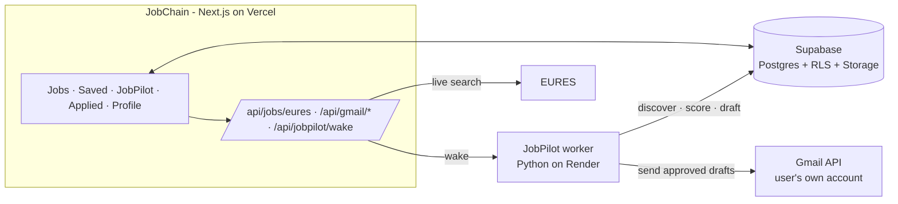

<div align="center">


# JobChain

**Find jobs, track every application, and apply faster.**

JobChain brings remote and European job openings into one place, keeps your applications organised, and uses **JobPilot**, a rule-based assistant, to find roles that fit you and draft tailored application emails you approve before anything is sent.

[Live app](https://job-chain.vercel.app) · [Features](#features) · [How it works](#how-it-works) · [Getting started](#getting-started)


</div>

---

## Features

### Jobs
- **Remote openings** from Remotive, plus a **live search across Europe** (EURES and Arbeitnow) by job title and country.
- Search several titles at once (`Frontend Developer, React Developer`); results are merged so each title shows near the top.
- **Bookmark** anything to come back to later. Every job links to its original ad.

### Applied
- Track every application and move it through **applied → interview → offer / rejected**.
- See where everything stands at a glance.

### JobPilot, your application assistant
- **Finds matching roles** across Europe for your profile (skills, languages, experience, locations).
- **Scores each job with transparent rules, not AI**: *Strong / Possible / Unlikely*, with the reasons, blockers and unknowns behind every score.
- **Drafts a tailored email** for each vacancy, with your CV attached.
- **You stay in control:** you review every draft, and only the ones you approve are sent, from **your own Gmail**, with a cap on sends per run.
- **Hard rules:** it never guesses an email address, never claims a skill or language you didn't confirm, and never assumes visa sponsorship.

### Built for phones too
- An installable app with a Home Screen icon and bottom tabs (Jobs · Saved · JobPilot · Applied · Profile).

---

## Tech stack

| Layer | What |
|---|---|
| Frontend | [Next.js 15](https://nextjs.org) (App Router, JavaScript), React 19, Tailwind CSS 4, lucide-react, anime.js |
| Auth & data | [Supabase](https://supabase.com): email/password auth, Postgres with Row Level Security, private Storage for CVs |
| Email | Google OAuth with the **send-only** `gmail.send` scope; each user sends from their own Gmail |
| Worker | JobPilot (Python) in the separate [`jobchain-backend`](https://github.com/sanskardev9) repo, deployed on Render |
| Hosting | [Vercel](https://vercel.com) |

---

## How it works



1. **Discover**: the worker collects vacancies from EURES and Arbeitnow, and the app adds an instant live EURES search for typed queries.
2. **Score**: each job's requirements are matched against your candidate profile with explainable rules.
3. **Draft**: for good matches, JobPilot writes a vacancy-specific email with your CV.
4. **Approve and send**: you review the drafts in JobChain. Approved ones are sent through the Gmail API using your own connected account, and each send is tracked in **Applied**.

Gmail refresh tokens are stored encrypted (`GMAIL_TOKEN_KEY`, shared with the worker). The Supabase service-role key lives only on the worker, never in the Next.js app.

---

## Getting started

### Prerequisites
- **Node.js 20+**
- A Supabase project
- A Google Cloud OAuth **Web** client with the Gmail API enabled (scope `gmail.send`)
- The JobPilot worker (`jobchain-backend`) for discovery, scoring and sending (optional for browsing and tracking)

### 1. Install

```bash
git clone https://github.com/sanskardev9/Job-Chain.git
cd Job-Chain
npm install
```

### 2. Environment variables

Create `.env.local`:

```bash
NEXT_PUBLIC_SUPABASE_URL=
NEXT_PUBLIC_SUPABASE_ANON_KEY=
NEXT_PUBLIC_JOBPILOT_WORKER_URL=
GOOGLE_CLIENT_ID=
GOOGLE_CLIENT_SECRET=
GMAIL_TOKEN_KEY=
SUPABASE_SERVICE_ROLE_KEY=
CRON_SECRET=
NEXT_PUBLIC_VAPID_PUBLIC_KEY=
VAPID_PRIVATE_KEY=
```

| Variable | Used by | Notes |
|---|---|---|
| `NEXT_PUBLIC_SUPABASE_URL`, `NEXT_PUBLIC_SUPABASE_ANON_KEY` | Browser | Row Level Security keeps each user's data private |
| `NEXT_PUBLIC_JOBPILOT_WORKER_URL` | Browser | Where the JobPilot worker runs (for "wake up and run now") |
| `GOOGLE_CLIENT_ID`, `GOOGLE_CLIENT_SECRET` | **Server only** | OAuth Web client for connecting Gmail |
| `GMAIL_TOKEN_KEY` | **Server only** | Encrypts Gmail tokens; **must match the worker's value** |
| `SUPABASE_SERVICE_ROLE_KEY` | **Server only** | Lets the protected scheduler queue eligible users' daily searches; never exposed to the browser |
| `CRON_SECRET` | **Server only** | Authorizes `/api/cron/jobpilot`; Vercel sends it automatically to configured cron requests |
| `NEXT_PUBLIC_VAPID_PUBLIC_KEY`, `VAPID_PRIVATE_KEY` | Browser / **server only** | Web Push keys for owner Gmail-request notifications (`npx web-push generate-vapid-keys`) |

### 3. Database

Run `supabase/schema.sql` in the Supabase SQL editor. It creates the tables (profiles, jobs, candidate profiles, discovered jobs, application drafts, pipeline runs and events, email accounts and tokens, job pool) along with their Row Level Security policies.

The included Vercel cron checks daily for users active within the last seven days. Each eligible user gets at most one search every 24 hours; JobPilot finds, scores and drafts automatically, but never sends without approval.

While the Google OAuth app is in testing, users request access for the exact Gmail address they want to connect. The owner account (`sanskar.dev09@gmail.com`) reviews requests in `/admin`, adds the address under Google Cloud OAuth test users, then marks it approved. The callback refuses any Google account that does not match an approved request. The owner can enable browser request alerts from the Admin sidebar after VAPID keys are configured.

### 4. Run

```bash
npm run dev     # http://localhost:3000
```

| Script | What it does |
|---|---|
| `npm run dev` | Development server |
| `npm run build` | Production build |
| `npm start` | Serve the production build |
| `npm run lint` | Lint |

---

## Project structure

```text
src/
  app/
    home/  jobs/  bookmarks/  applied/  jobpilot/  drafts/  profile/  login/  gmail/
    api/
      jobs/eures/       live EURES search
      gmail/            OAuth URL + code exchange (connect your Gmail)
      jobpilot/wake/    wake the worker for a run
      cron/jobpilot/    queue daily searches for recently active users
      gmail/request-access/ Gmail test-user request workflow
      admin/             owner-only dashboard data and approvals
      push/subscribe/    owner browser notification subscription
  components/           job cards, tabs, landing, search progress
  lib/                  Supabase client, countries, helpers
supabase/schema.sql     database schema and RLS policies
docs/                   product and JobPilot design docs
```

---

## Data sources and attribution

Job listings come from **[EURES](https://eures.europa.eu)** (the European Job Mobility Portal, European Commission), **[Arbeitnow](https://www.arbeitnow.com)** and **[Remotive](https://remotive.com)**. Every listing links back to its original ad, and the rights to vacancy content stay with the organisations that published it. JobChain is an independent project and is **not affiliated with or endorsed by** EURES, the European Commission, Arbeitnow or Remotive. Requests are kept low-volume and identify the app. Anyone using this code for a public or commercial service should get permission from the data providers (for EURES, through the European Labour Authority).

---

## Privacy and security

- **Row Level Security** on every table: users only see their own jobs, drafts and profile.
- **Private CVs:** they're stored in private Supabase Storage.
- **Narrow Gmail access:** it's **send-only** (`gmail.send`). JobChain can't read your inbox. Tokens are encrypted, and you can disconnect at any time.
- **Nothing sent without you:** no email goes out without your approval, and sends per run are capped.
- **Google verification:** while the Google OAuth consent screen is in *Testing*, it's limited to 100 test users. Opening it to the public needs Google's verification for the Gmail scope.

---

<div align="center">

Built by **[Sanskar Singh](https://github.com/sanskardev9)**

</div>
